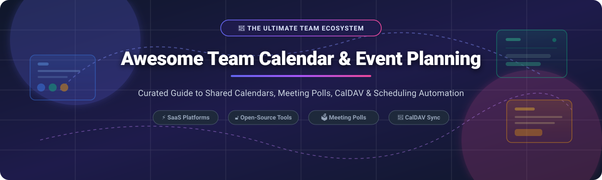

# 📅 Awesome Team Calendar & Event Planning

**A curated directory of top-tier SaaS solutions and open-source software for team calendar management, scheduling automation, group meeting polls, and self-hosted CalDAV synchronization.**

  
  
  
  
  

---

## 🧭 Table of Contents
- [🔍 Sector Overview & Market Dynamics](#-sector-overview--market-dynamics)
- [☁️ SaaS & Hosted Platforms](#️-saas--hosted-platforms)
- [🔓 Open-Source GitHub Projects](#-open-source-github-projects)
  - [⚡ Top Open-Source Repositories (Ranked by Stars)](#-top-open-source-repositories-ranked-by-stars)
  - [🧩 Categorized Breakdown](#-categorized-breakdown)
- [🤝 How to Contribute](#-how-to-contribute)
- [💖 Support & Sponsorship](#-support--sponsorship)
- [📈 Star History](#-star-history)
- [⚖️ Disclaimer](#️-disclaimer)

---

## 🔍 Sector Overview & Market Dynamics

The global team calendar, appointment scheduling, and event planning software market is estimated at **$2.5 billion in 2024 and projected to reach over $5.8 billion by 2030**, growing at a CAGR of ~15.2%. 

The sector exhibits **moderate-to-high concentration at the baseline infrastructure layer** (heavily dominated by Microsoft 365 Exchange/Outlook and Google Workspace, representing a classic winner-take-most dynamic for enterprise directory identity and core calendars), while remaining **moderately fragmented in the specialized scheduling automation, meeting intelligence, and group polling overlays** where standalone agile platforms (e.g., Calendly, Doodle, Clockwise) and open-source self-hosted alternatives (e.g., Cal.diy, Rallly, Radicale) compete dynamically for specialized workflow ownership.

---

## ☁️ SaaS & Hosted Platforms

*Below is a comprehensive comparison of leading commercial team calendar and scheduling software platforms, sorted descending by company size (valuation / annual revenue).*

| 🏢 Product | 💰 Starting Tier Pricing | 🎁 Free Tier Limit / Trial Duration | 📊 Company Size (Valuation / Revenue) | 📝 Description |
| :--- | :--- | :--- | :--- | :--- |
| **[Google Calendar](https://calendar.google.com/)** | $6.00 / user / month (Google Workspace Business Starter) | Free forever personal account (15 GB shared storage across Drive/Gmail/Photos); 14-day free trial for Google Workspace | **$2.2 Trillion market cap** (Alphabet parent company; ~$350B+ annual revenue) | De facto standard for web-first team calendars; integrates with Gmail, Google Meet, and Google Workspace with granular access and room resources. |
| **[Outlook Calendar](https://www.microsoft.com/en-us/microsoft-365/outlook/email-and-calendar-software-microsoft-outlook)** | $6.00 / user / month (Microsoft 365 Business Basic, annual commit) | Free forever personal web tier (15 GB mailbox, 5 GB OneDrive); 30-day free trial for Microsoft 365 Business plans | **$3.1 Trillion market cap** (Microsoft Corporation; ~$245B+ annual revenue) | Standard enterprise calendar backbone within Microsoft 365; deep Teams, Exchange, and room booking scheduling assistant integration. |
| **[Confluence Team Calendars](https://www.atlassian.com/software/confluence)** | $6.05 / user / month (Confluence Standard plan) | Free forever plan for up to 10 users with 2 GB storage; 7-day free trial on paid tiers | **$50 Billion market cap** (Atlassian Corporation; ~$4.4B annual revenue) | Collaborative team workspace calendar integration; tracks team leave, sprint milestones, Jira dates, and project releases. |
| **[Asana Calendar](https://asana.com/)** | $10.99 / user / month (Asana Starter, billed annually) | Free forever plan for up to 10 teammates with unlimited tasks and basic calendar view; 30-day free trial for paid tiers | **$3.2 Billion market cap** (Asana Inc.; ~$700M+ annual revenue) | Dedicated calendar view within project workflows; allows visualizing team milestones, deadlines, and project schedules alongside tasks. |
| **[Monday Calendar](https://monday.com/)** | $9.00 / seat / month (monday.com Basic Work Management, min 3 seats) | Free forever plan for up to 2 seats with up to 3 boards and 200 items; 14-day free trial of Pro plan | **$14.5 Billion market cap** (monday.com Ltd.; ~$840M+ annual revenue) | High-flexibility calendar & timeline widgets within monday Work OS for tracking deliverables, team events, and resource availability. |
| **[Calendly](https://calendly.com/)** | $10.00 / seat / month (Standard plan, billed annually) | Free forever plan for 1 user, 1 active event type, and 1 calendar connection; 14-day free trial of Teams features | **$3.0 Billion valuation** (~$150M+ ARR) | Benchmark for external scheduling automation; share custom links to book meetings, collect payments, and sync calendar availability. |
| **[Doodle](https://doodle.com/)** | $6.95 / user / month (Pro plan, billed annually) | Free forever plan for group polls with ads and core booking page; 14-day free trial of Doodle Pro | **$100 Million+ estimated valuation** (Owned by TX Group; ~$25M+ ARR) | Cross-organization meeting poll pioneer; participants vote on proposed time windows without mandatory user registration. |
| **[Clockwise](https://www.getclockwise.com/)** | $6.75 / user / month (Clockwise Teams, billed annually) | Free forever plan for individuals and small teams with 10 smart meeting moves/month; 14-day free trial of Business tier | **$400 Million valuation** (~$25M+ ARR, backed by Accel & Bain Capital) | AI-powered calendar assistant that automatically balances schedules, resolves meeting conflicts, and protects uninterrupted focus time. |
| **[Cal.com](https://cal.com/)** | $12.00 / user / month (Cal.com Teams tier) | Free forever individual plan with unlimited booking links and unlimited event types; 14-day free trial for Teams | **$120 Million+ valuation** (~$10M ARR, Series A funded) | Commercial hosted edition of the open-source Cal scheduling platform; provides team routing, round-robin, automated workflows, and SSO. |
| **[Teamup](https://www.teamup.com/)** | $12.00 / calendar / month (Plus plan, supporting multiple users) | Free forever plan with up to 8 sub-calendars, 1-year history, and simple link-based access control; no credit card needed | **$20 Million+ estimated valuation** (Independent profitable SaaS) | Group and organizational shared calendar system featuring flexible sub-calendars, color coding, and permission-controlled shareable links without mandatory user accounts. |

---

## 🔓 Open-Source GitHub Projects

### ⚡ Top Open-Source Repositories (Ranked by Stars)

*All repositories are sorted descending by community popularity and GitHub Stars_Count.*

| 📦 Repository | ⭐ GitHub_Stars | ⚖️ License | 🛠️ Tech Stack | 📌 Primary Focus |
| :--- | :--- | :--- | :--- | :--- |
| **[calcom/cal.com](https://github.com/calcom/cal.com)** |  | AGPL-3.0 / Commercial | Next.js, TypeScript, PostgreSQL, Prisma | Enterprise & community scheduling platform with round-robin, integrations & workflows |
| **[fullcalendar/fullcalendar](https://github.com/fullcalendar/fullcalendar)** |  | MIT | TypeScript, JavaScript | Flexible full-sized calendar UI component for React, Vue, Angular, and vanilla web apps |
| **[nhn/tui.calendar](https://github.com/nhn/tui.calendar)** |  | MIT | JavaScript, TypeScript | Feature-rich JavaScript drag-and-drop calendar display component with day/week/month views |
| **[lukevella/rallly](https://github.com/lukevella/rallly)** |  | AGPL-3.0 | Next.js, Node.js, Prisma, PostgreSQL | Collaborative Doodle alternative for meeting polls with no-account guest voting & ICS export |
| **[Kozea/Radicale](https://github.com/Kozea/Radicale)** |  | GPL-3.0 | Python | Ultra-lightweight CalDAV/CardDAV calendar & contact server (<50 MB RAM) |
| **[alextselegidis/easyappointments](https://github.com/alextselegidis/easyappointments)** |  | GPL-3.0 | PHP, CodeIgniter, MySQL | Self-hosted appointment scheduling management system for customer and team bookings |
| **[sabre-io/Baikal](https://github.com/sabre-io/Baikal)** |  | GPL-3.0 | PHP, SQLite/MySQL, sabre/dav | Lightweight CalDAV/CardDAV server equipped with a dedicated web administrative management dashboard |
| **[vdirsyncer/vdirsyncer](https://github.com/vdirsyncer/vdirsyncer)** |  | MIT | Python | Multi-way CLI synchronization tool for CalDAV calendars and CardDAV contacts |
| **[nextcloud/calendar](https://github.com/nextcloud/calendar)** |  | AGPL-3.0 | Vue.js, PHP, Nextcloud | Complete Google Calendar-like web interface with drag-and-drop, room booking, and CalDAV sync |
| **[suitenumerique/calendars](https://github.com/suitenumerique/calendars)** |  | MIT | Next.js, Django, SabreDAV | Modern collaborative workspace calendar with granular role access controls |
| **[jawanndenn/jawanndenn](https://github.com/jawanndenn/jawanndenn)** |  | AGPL-3.0 | Python | Minimalist, privacy-friendly self-hosted poll and date coordinator without complex dependencies |

---

### 🧩 Categorized Breakdown

#### 🕒 1. Scheduling Automation (Calendly Alternatives)
- **[Cal.com / Cal.diy](https://github.com/calcom/cal.com)**   
  MIT/AGPL core scheduling engine. Share a personalized link, define availability buffers, integrate with Google/Outlook calendars and Zoom/Google Meet video conferencing, and take payments.
- **[Easy!Appointments](https://github.com/alextselegidis/easyappointments)**   
  Highly extensible appointment scheduler tailored for team services, consultants, and multi-attendant booking workflows.

#### 🗳️ 2. Meeting Polls (Doodle Alternatives)
- **[Rallly](https://github.com/lukevella/rallly)**   
  Elegant Doodle alternative supporting anonymous voting, magic links, multi-language internationalization, and ICS calendar invites.
- **[jawanndenn](https://github.com/jawanndenn/jawanndenn)**   
  Single-process, lightweight meeting poll tool designed for fast self-hosting without external database servers.

#### 📅 3. Shared Calendars & CalDAV Servers
- **[Nextcloud Calendar](https://github.com/nextcloud/calendar)**   
  Full-fledged modern web calendar matching Google Calendar's UI; built directly into the Nextcloud private cloud ecosystem.
- **[Radicale](https://github.com/Kozea/Radicale)**   
  Zero-database, file-backed CalDAV/CardDAV server consuming less than 50 MB of memory; integrates directly with Thunderbird, Apple Calendar, and DAVx⁵.
- **[Baïkal](https://github.com/sabre-io/Baikal)**   
  Clean PHP/sabreDAV server with an intuitive admin dashboard for managing users, calendar access rights, and address books.
- **[Calendars (suitenumerique)](https://github.com/suitenumerique/calendars)**   
  Modern team calendar engine featuring team workspaces, calendar sharing, and granular permissions.

#### 🧰 4. UI Components & Sync Libraries
- **[FullCalendar](https://github.com/fullcalendar/fullcalendar)**   
  The industry-standard client-side calendar framework with timeline view, resource scheduling, drag-and-drop, and rich event handling.
- **[TOAST UI Calendar (tui.calendar)](https://github.com/nhn/tui.calendar)**   
  JavaScript calendar component providing daily, weekly, and monthly views with customizable popups and event creation mechanics.
- **[vdirsyncer](https://github.com/vdirsyncer/vdirsyncer)**   
  Command-line tool that synchronizes CalDAV calendars between remote servers and local directories.

---

## 🤝 How to Contribute

We welcome community contributions! To suggest new tools or update pricing and features:

1. 🍴 Fork this repository on GitHub.
2. 🌿 Create a new branch (`git checkout -b feature/suggest-tool`).
3. ✏️ Update `README.md` with factual information and relevant badges.
4. 🚀 Push your branch and open a Pull Request.

---

## 💖 Support & Sponsorship

Thank you for exploring and utilizing the **Awesome Team Calendar & Event Planning** repository! If this curated ecosystem guide saved your organization time or helped you architect your scheduling infrastructure, please consider supporting ongoing maintenance:

- ⭐ **Star the repository** to boost visibility and help others discover it.
- 🍴 **Fork and share** with your engineering and operations teams.
- ☕ **Sponsor the creator & buy a coffee** via the [GitHub Sponsor Dashboard](https://github.com/sponsors/ishandutta2007).

Your backing directly enables active maintenance, periodic pricing verification, and new open-source discovery!

---

## 📈 Star History

---

## ⚖️ Disclaimer

- This repository is a community-curated directory intended solely for educational, architectural, and informational purposes. Product names, logos, and brands are property of their respective owners.
- Self-hosted CalDAV servers and open-source scheduling engines require appropriate infrastructure configuration, SSL/TLS certificates, routine database backups, and data protection compliance (e.g., GDPR, HIPAA).
- Pricing tiers and trial terms are subject to change by vendors; always consult the vendor's official pricing page for up-to-date quotes.

---

  Maintained with care by the open-source community. Discover more curated stacks at <a href="https://github.com/ishandutta2007/Awesome-Awesome-Awesome">Awesome-Awesome-Awesome</a>.

